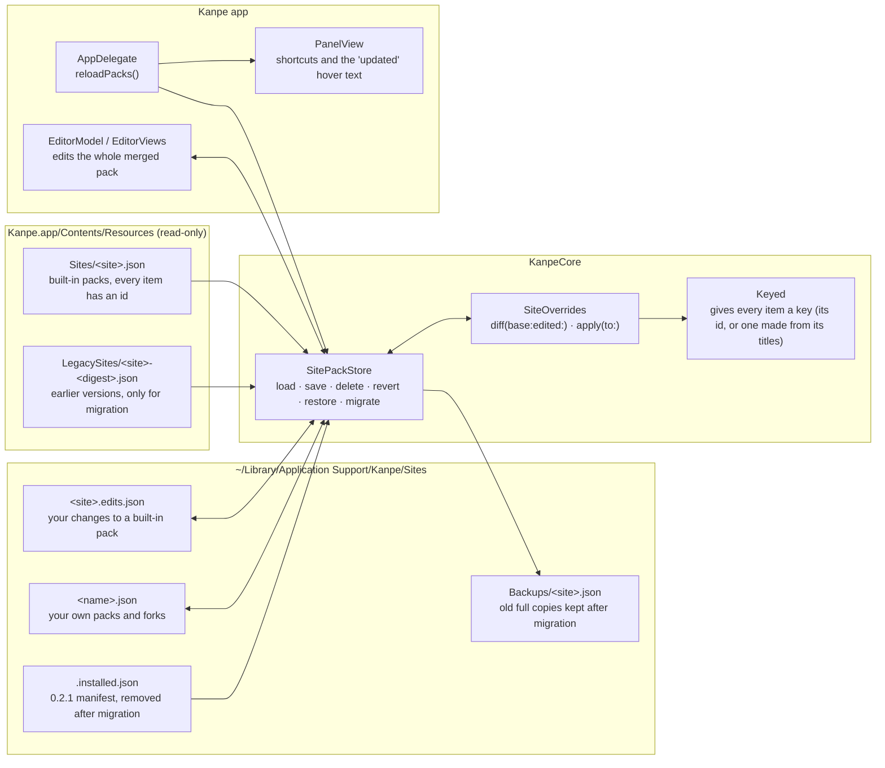
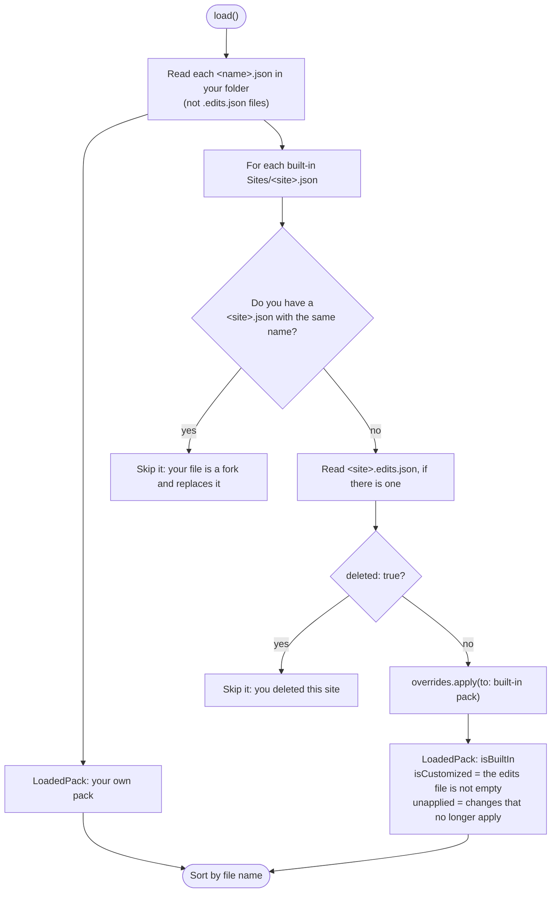
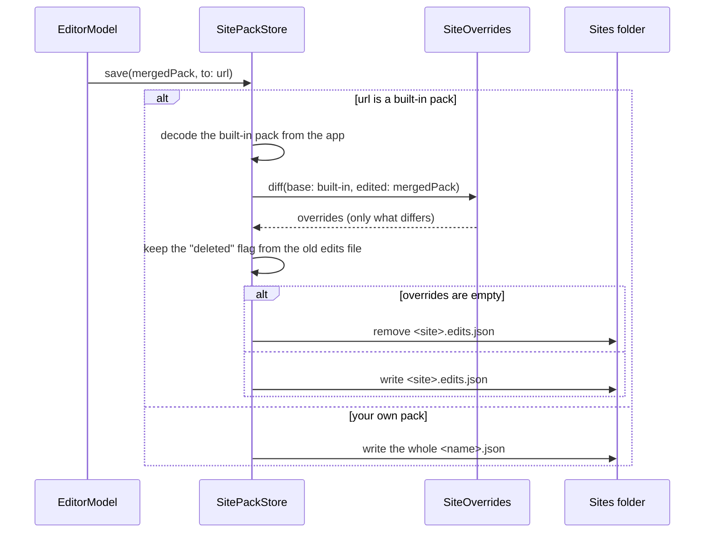
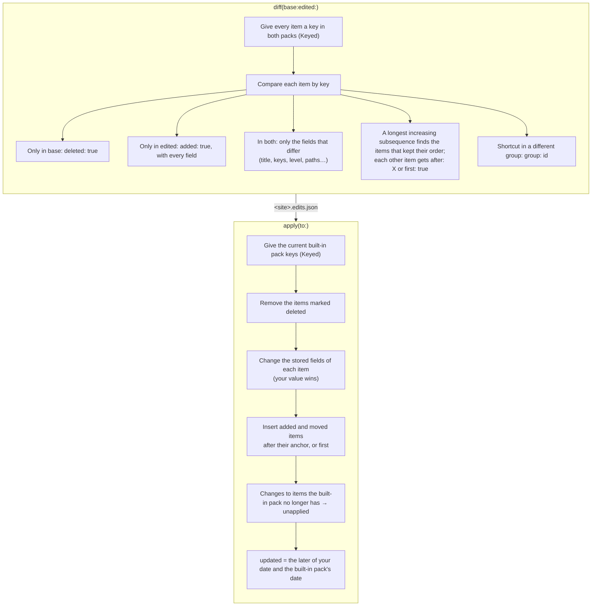
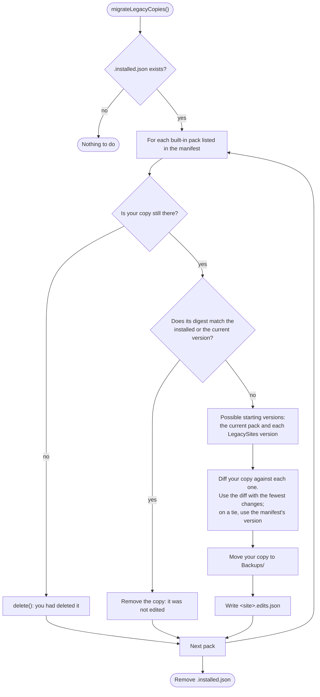

# How your changes to built-in sites are stored and merged

Kanpe ships some site packs in the app: GitHub, Gmail, YouTube and Figma. You can change these
built-in packs in the editor, and a new version of Kanpe can change them too. Kanpe never copies
a built-in pack into your folder. It stores only your changes, in `<site>.edits.json`, and
applies them to the current built-in pack each time it loads. So each app update arrives, and
your changes stay on top of it.

Code: `Sources/KanpeCore/Overrides.swift` (`SiteOverrides`) and
`Sources/KanpeCore/SitePacks.swift` (`SitePackStore`).

## Components and files



## Loading

`SitePackStore.load()` builds the list of packs that the panel and the editor use.



## Saving from the editor

The editor works on the merged pack and never sees the edits file. On save, the store works out
what now differs from the built-in pack and rewrites the whole edits file.



Other operations on a built-in pack also change only its edits file:

| Operation | What happens to `<site>.edits.json` |
|---|---|
| `delete` | sets `deleted: true` and keeps your changes |
| `restoreDeletedBuiltIns` | removes `deleted`, so the site comes back with your changes |
| `revertToBuiltIn` | removes the file |

## Diff and apply



How the merge works:

- **Keys.** An item's key is its `id`, which stays the same when the item is renamed or moved.
  An item without an id gets a key made from its titles, such as `p:name`, `g:title` or
  `s:group/title`. A `#2` suffix makes a key unique within its kind.
- **One field at a time.** If you change a shortcut's keys and an update fixes its title, you
  get both changes.
- **Lists are replaced whole.** These are `match`, a page's `paths` and a group's `pages`.
- **Relative positions.** A new built-in item that your changes don't mention keeps its place
  in the built-in order. Your added and moved items go after their anchor.
- **Conflicts.** If you and an update change the same field, your value wins.
- **Items an update removed.** Changes to them are listed in `unapplied` and shown in the
  editor. The next save drops them.
- **Levels.** `"level": "inherit"` clears a level, so the shortcut takes its group's level.

Example `github.edits.json`:

```json
{
  "updated": "2026-11-10",
  "shortcuts": {
    "code.open-blame":   { "level": "inherit" },
    "code.jump-to-line": { "level": "inherit" }
  }
}
```

## Migrating from 0.2.1 full copies

Kanpe 0.2.1 copied each built-in pack into your folder and recorded a digest of each copy in
`.installed.json`. On the first launch of the new version, `migrateLegacyCopies` turns those
copies into edits files. Because it removes the manifest at the end, it runs only once.



The closest version is used, not simply the one the manifest names, because a copy can be
changed by hand without the manifest being updated. If the manifest's version were always used,
those hand-made changes would be stored as your edits.
